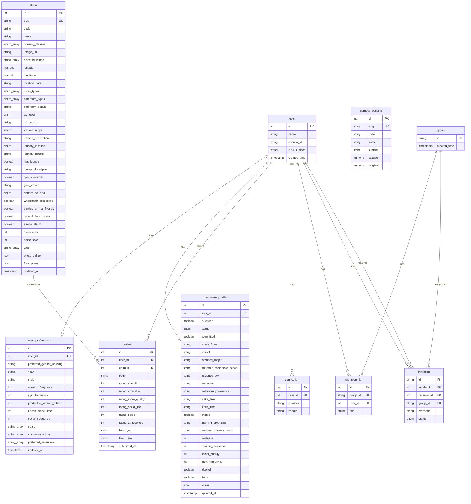

# Database Codebook

Our project uses PostGres SQL DB to serve our frontend with data storage and migrations. This document serves as a guide, or codebook, on what each value and data point is from our DB.

Schema is defined with [Drizzle ORM](https://orm.drizzle.team/) in `apps/backend/src/db/schema.ts`. Drizzle generates TypeScript types from these table definitions, so the shapes below stay in sync with the code as long as the schema file is the source of truth.

## Schema Diagram

Below is the working diagram made for our database schema which is also additionally produced in [Lucid Chart](https://lucid.app/lucidchart/cb169728-397a-4993-801b-1c5beeed62b9/edit?viewport_loc=-1247%2C-628%2C2856%2C1716%2C0_0&invitationId=inv_0eebfa91-3957-4426-a47b-316f727e67d6).



> **Note:** `connection`, `group`, `membership`, and `invitation` are not yet defined in `apps/backend/src/db/schema.ts` or in this documentation as they will be made and used when we create the Roomies.live OpenAPI. They're included above to match the current [lucid chart diagram](https://lucid.app/lucidchart/cb169728-397a-4993-801b-1c5beeed62b9/edit?viewport_loc=-1247%2C-628%2C2856%2C1716%2C0_0&invitationId=inv_0eebfa91-3957-4426-a47b-316f727e67d6), but the **Tables** and **TypeScript types** sections below only cover the six tables that actually exist in the Drizzle schema currently (`user`, `user_preferences`, `roommate_profile`, `dorm`, `campus_building`, `review`). Once those four tables are added to `schema.ts`, this doc will be updated with their column/type details too.

## Enums

### `roommate_status`

Backing type for `roommate_profile.status`.

| Value | Meaning |
| -- | -- |
| `searching` | User is actively looking for a roommate. |
| `committed` | User has locked in a roommate/room situation. |
| `inactive` | User is not currently participating in roommate matching. |

### Building enums

Backing types for the `dorm` columns below. Each one mirrors the string enum of the same name in `apps/frontend/src/data/buildingTypes.ts`, and the values must stay identical in both places (`deno task db:seed` rejects any building whose value is not in the Postgres enum). What each value means is documented in [data-codebook.md](data-codebook.md#enums).

| Postgres enum | Used by | Values |
| -- | -- | -- |
| `room_type` | `dorm.room_types` (array) | `trad_single`, `trad_double`, `trad_triple`, `semi_suite_single`, `semi_suite_double`, `semi_suite_triple`, `semi_suite_quad`, `apartment_triple`, `studio_apartment_single`, `studio_apartment_double` |
| `bathroom_type` | `dorm.bathroom_types` (array) | `communal`, `shared_suite`, `private` |
| `ac_level` | `dorm.ac_level` | `none`, `by_necessity`, `window`, `central` |
| `laundry_location` | `dorm.laundry_location` | `none`, `basement`, `each_floor`, `in_unit` |
| `kitchen_scope` | `dorm.kitchen_scope` | `none`, `shared`, `in_unit` |
| `gender_housing` | `dorm.gender_housing` | `co_ed`, `women_only`, `men_only`, `gender_inclusive` |
| `housing_class` | `dorm.housing_classes` (array) | `first_year`, `upperclass` |

## Tables

### `user`

Core account record. Every other table hangs off of `user.id`.

| Column | DB type | Nullable | Notes |
| -- | -- | -- | -- |
| `id` | `serial` | No (PK) | Auto-incrementing primary key. |
| `andrew_id` | `text` | Yes | CMU AndrewID for the account. |
| `created_time` | `timestamp` | Yes | When the account was created. |
| `name` | `text` | Yes | Display name. |
| `oidc_subject` | `text` | Yes | Subject claim from the OIDC identity provider (CMU SSO), used to link the login to this row. |

### `user_preferences`

One-to-one extension of `user` holding lifestyle/roommate-matching preferences.

| Column | DB type | Nullable | Notes |
| -- | -- | -- | -- |
| `id` | `serial` | No (PK) | Auto-incrementing primary key. |
| `user_id` | `integer` | No (FK -> `user.id`) | Owning user. |
| `accommodations` | `text[]` | Yes | List of accessibility/accommodation needs. |
| `cooking_frequency` | `integer` | Yes | Self-reported frequency scale (e.g. times per week). |
| `goals` | `text[]` | Yes | Free-text goals for housing/roommate search. |
| `gym_frequency` | `integer` | Yes | Self-reported frequency scale. |
| `major` | `text` | Yes | Academic major. |
| `needs_alone_time` | `integer` | Yes | Self-reported scale of how much alone time is needed. |
| `preferred_amenities` | `text[]` | Yes | Desired building/room amenities. |
| `preferred_gender_housing` | `text` | Yes | Preferred gender composition for housing. |
| `productive_around_others` | `integer` | Yes | Self-reported scale of productivity with others present. |
| `social_frequency` | `integer` | Yes | Self-reported social activity scale. |
| `updated_at` | `timestamp` | Yes | Last time preferences were edited. |
| `year` | `text` | Yes | Class year (e.g. Freshman, Sophomore). |

### `roommate_profile`

One-to-one extension of `user` holding the public-facing roommate-matching profile.

| Column | DB type | Nullable | Notes |
| -- | -- | -- | -- |
| `id` | `serial` | No (PK) | Auto-incrementing primary key. |
| `user_id` | `integer` | No (FK -> `user.id`) | Owning user. |
| `alcohol` | `boolean` | Yes | Whether the user drinks alcohol. |
| `assigned_sex` | `text` | Yes | Assigned sex, used for housing-eligibility matching. |
| `bathroom_preference` | `text` | Yes | Preferred bathroom arrangement. |
| `committed` | `boolean` | Yes | Whether the user has already committed to a roommate. |
| `drugs` | `boolean` | Yes | Whether the user uses drugs. |
| `extras` | `json` | Yes | Free-form additional profile data not modeled as columns. |
| `intended_major` | `text` | Yes | Intended/declared major shown on the profile. |
| `is_visible` | `boolean` | Yes | Whether the profile is visible in roommate search. |
| `morning_prep_time` | `text` | Yes | How long the user takes to get ready in the morning. |
| `neatness` | `integer` | Yes | Self-reported tidiness scale. |
| `party_frequency` | `integer` | Yes | Self-reported partying frequency scale. |
| `preferred_roommate_school` | `text` | Yes | Preferred school/college affiliation of a roommate. |
| `preferred_shower_time` | `text` | Yes | Preferred time of day to shower. |
| `pronouns` | `text` | Yes | User's pronouns. |
| `school` | `text` | Yes | User's own school/college affiliation. |
| `sleep_time` | `text` | Yes | Typical bedtime. |
| `snores` | `boolean` | Yes | Whether the user snores. |
| `social_energy` | `integer` | Yes | Self-reported social energy scale. |
| `status` | `roommate_status` enum | Yes | One of `searching`, `committed`, `inactive`. |
| `updated_at` | `timestamp` | Yes | Last time the profile was edited. |
| `volume_preference` | `integer` | Yes | Preferred noise/volume level scale. |
| `wake_time` | `text` | Yes | Typical wake-up time. |
| `where_from` | `text` | Yes | Hometown/origin. |

### `dorm`

Reference data for CMU residence halls, shared across all users (not tied to a `user_id`). One row per entry in `apps/frontend/src/data/buildings.json`, loaded by migration `0009_dorm_data` and by `deno task db:seed` (see [Seeding dorm data](#seeding-dorm-data)). The frontend reads these rows through `GET /api/buildings`, which nests the columns into the `Building` shape from [data-codebook.md](data-codebook.md) and attaches each dorm's review summary (`reviews.count` and the four rating averages).

| Column | DB type | Nullable | Notes |
| -- | -- | -- | -- |
| `id` | `serial` | No (PK) | Auto-incrementing primary key. Other tables reference this. |
| `slug` | `text` | No (unique) | Stable URL-safe identifier, the `id` string from `buildings.json` (e.g. `etower`). Frontend URLs depend on it. |
| `ac_details` | `text` | Yes | Description of air conditioning setup. |
| `ac_level` | `ac_level` | No | Level of air conditioning. |
| `bathroom_details` | `text` | Yes | Description of bathroom facilities. |
| `bathroom_types` | `bathroom_type[]` | No | Every bathroom style the building offers. |
| `close_buildings` | `text[]` | Yes | Slugs of the nearest academic or non-residential campus buildings (see [`campus_building`](#campus_building)). Not a foreign key. |
| `code` | `text` | No | Short label shown on the map marker (e.g. `MOE`). Not unique: a dorm can share its code with a campus building (Resnik). |
| `floor_plans` | `json` | No (default `[]`) | Array of `FloorPlan` (`link`, `description`, `category`, optional `virtualTourLink`). |
| `gender_housing` | `gender_housing` | No | Gender housing policy. |
| `ground_floor_rooms` | `boolean` | No | Whether the building has ground-floor rooms. |
| `gym_available` | `boolean` | No | Whether there is a gym. |
| `gym_details` | `text` | Yes | Description of the gym. |
| `has_lounge` | `boolean` | No | Whether the building has a lounge. |
| `housing_classes` | `housing_class[]` | No | Which students the building houses: first-year, upperclass, or both. |
| `image_url` | `text` | Yes | Primary/cover image for the dorm. |
| `kitchen_description` | `text` | Yes | Description of kitchen facilities. |
| `kitchen_scope` | `kitchen_scope` | No | Who has access to a kitchen. |
| `latitude` | `numeric` | Yes | Geographic latitude. |
| `laundry_details` | `text` | Yes | Description of laundry facilities. |
| `laundry_location` | `laundry_location` | No | Where laundry is located. |
| `location_note` | `text` | Yes | Freeform note about the building's location. |
| `longitude` | `numeric` | Yes | Geographic longitude. |
| `lounge_description` | `text` | Yes | Description of lounge/common space. |
| `name` | `text` | No | Dorm name. |
| `noise_level` | `integer` | Yes | Fallback for `atmosphere.noiseLevel` (5 is quiet), used only while no review has a noise rating. Null for every dorm today. |
| `photo_gallery` | `json` | Yes | Array of `GalleryImage` (`link`, `description`). |
| `room_types` | `room_type[]` | No | Room configurations offered. |
| `service_animal_friendly` | `boolean` | No | Accessibility: service animals allowed. |
| `socialness` | `integer` | Yes | Fallback for `atmosphere.socialness`, used only while no review has a social life rating. Null for every dorm today. |
| `strobe_alarm` | `boolean` | No | Accessibility: strobe fire alarms. |
| `tags` | `text[]` | Yes | Freeform editorial tags (`editorialTags` in `buildings.json`). |
| `updated_at` | `timestamp` | Yes | Last time the dorm record was edited. |
| `wheelchair_accessible` | `boolean` | No | Accessibility: wheelchair accessible. |

### `campus_building`

Reference data for academic and other non-residential buildings, shared across all users. One row per entry in `apps/frontend/src/data/campusBuildings.json`, loaded by migration `0008_building_data` and by `deno task db:seed`, and served by `GET /api/campus-buildings`. They are the map's origin picker, the "Distance from" filter options and the targets of `dorm.close_buildings`.

| Column | DB type | Nullable | Notes |
| -- | -- | -- | -- |
| `id` | `serial` | No (PK) | Auto-incrementing primary key. |
| `slug` | `text` | No (unique) | Stable URL-safe identifier, the `id` string from `campusBuildings.json` (e.g. `baker-hall`). |
| `code` | `text` | No | Short label shown on the map marker. |
| `latitude` | `numeric` | No | Geographic latitude (typed as `number`). |
| `longitude` | `numeric` | No | Geographic longitude (typed as `number`). |
| `name` | `text` | No | Building name. |
| `subtitle` | `text` | Yes | Department or function, shown under the name in the map's origin picker. |

### `review`

User-submitted reviews of a dorm. Many-to-one against both `user` and `dorm`.

| Column | DB type | Nullable | Notes |
| -- | -- | -- | -- |
| `id` | `serial` | No (PK) | Auto-incrementing primary key. |
| `dorm_id` | `integer` | No (FK -> `dorm.id`) | Dorm being reviewed. |
| `user_id` | `integer` | No (FK -> `user.id`) | Author of the review. |
| `body` | `text` | Yes | Free-text review content. |
| `lived_term` | `text` | Yes | Term the reviewer lived there (e.g. Fall). |
| `lived_year` | `text` | Yes | Year the reviewer lived there. |
| `rating_amenities` | `integer` | Yes | Amenities rating. |
| `rating_atmosphere` | `integer` | Yes | Legacy atmosphere rating from reviews written before it was split into social life and noise. Nothing reads or writes it now. |
| `rating_noise` | `integer` | Yes | Noise rating, 1 to 5, where 5 is quiet. Null on reviews that predate the split. |
| `rating_overall` | `integer` | Yes | Overall rating. |
| `rating_room_quality` | `integer` | Yes | Room quality rating. |
| `rating_social_life` | `integer` | Yes | Social life rating, 1 to 5. Null on reviews that predate the split. |
| `submitted_at` | `timestamp` | Yes | When the review was submitted. |

The average `rating_social_life` and `rating_noise` of a dorm's reviews become that building's `atmosphere.socialness` and `atmosphere.noiseLevel` in `GET /api/buildings`, so the atmosphere filter follows what students report. The averages are calculated on every request and ignore reviews that have no value for them.

## Relationships

- `user (1) -> (1) user_preferences` via `user_preferences.user_id`
- `user (1) -> (1) roommate_profile` via `roommate_profile.user_id`
- `user (1) -> (many) review` via `review.user_id`
- `dorm (1) -> (many) review` via `review.dorm_id`
- `dorm.close_buildings` lists `campus_building.slug` values. It is a plain `text[]`, so the database does not enforce it; `deno task db:seed` checks it.

No `relations()` helpers are defined in `schema.ts` yet, so joins are written manually with Drizzle's query builder rather than the relational query API.

## Seeding dorm data

`apps/backend/scripts/seed-dorms.ts` copies every building in `apps/frontend/src/data/buildings.json` into the `dorm` table and every entry in `campusBuildings.json` into the `campus_building` table. Run it from `apps/backend` after the migrations have been applied:

```sh
deno task db:migrate
deno task db:seed
```

It is safe to re-run: rows are upserted on `slug`, so existing dorms are updated in place and keep their `id` (reviews point at it). Rows that were removed from the JSON files are not deleted. The script validates every enum value against the Postgres enums, and that every `closeBuildings` entry is a listed campus building, and stops without writing anything if one is wrong.

The migrations carry this data too, so a new database (a local one, a PR preview) comes up populated without running the seed. `0008_building_data` inserts the campus buildings and backfills `dorm.code` and `dorm.housing_classes`. `0009_dorm_data` upserts the 26 dorms from `buildings.json` as it stood when it was written. It matches on `slug`, so an existing row keeps its `id` (reviews point at it) and takes the JSON values, and a dorm that is not in the file is left alone. Migrations run once, when the server starts. A later change to a building (or a new one) reaches a database only through `deno task db:seed` or a new data migration, because the database is what the app reads.

## TypeScript types

Each table is a `pgTable` object, which Drizzle can turn into `select` (row-as-read) and `insert` (row-as-write) types via `InferSelectModel` / `InferInsertModel` (or the `$inferSelect` / `$inferInsert` shorthand). `Dorm` and `NewDorm` are already exported from `schema.ts` (using `$inferSelect` / `$inferInsert`). The others aren't hand-written anywhere yet, but adding them alongside the table definitions gives the rest of the app compile-time types for free:

```ts
import type { InferInsertModel, InferSelectModel } from "drizzle-orm";
import { userTable, userPreferencesTable, roommateProfileTable, dormTable, reviewTable } from "./schema.ts";

export type User = InferSelectModel<typeof userTable>;
export type NewUser = InferInsertModel<typeof userTable>;

export type UserPreferences = InferSelectModel<typeof userPreferencesTable>;
export type NewUserPreferences = InferInsertModel<typeof userPreferencesTable>;

export type RoommateProfile = InferSelectModel<typeof roommateProfileTable>;
export type NewRoommateProfile = InferInsertModel<typeof roommateProfileTable>;

export type Dorm = InferSelectModel<typeof dormTable>;
export type NewDorm = InferInsertModel<typeof dormTable>;

export type Review = InferSelectModel<typeof reviewTable>;
export type NewReview = InferInsertModel<typeof reviewTable>;
```

Resulting shapes (all nullable DB columns become `T | null` in the select type; `serial`/nullable columns become optional in the insert type):

```ts
type User = {
  id: number;
  andrewId: string | null;
  createdTime: Date | null;
  name: string | null;
  oidcSubject: string | null;
};

type UserPreferences = {
  id: number;
  userId: number;
  accommodations: string[] | null;
  cookingFrequency: number | null;
  goals: string[] | null;
  gymFrequency: number | null;
  major: string | null;
  needsAloneTime: number | null;
  preferredAmenities: string[] | null;
  preferredGenderHousing: string | null;
  productiveAroundOthers: number | null;
  socialFrequency: number | null;
  updatedAt: Date | null;
  year: string | null;
};

type RoommateProfile = {
  id: number;
  userId: number;
  alcohol: boolean | null;
  assignedSex: string | null;
  bathroomPreference: string | null;
  committed: boolean | null;
  drugs: boolean | null;
  extras: unknown | null; // json
  intendedMajor: string | null;
  isVisible: boolean | null;
  morningPrepTime: string | null;
  neatness: number | null;
  partyFrequency: number | null;
  preferredRoommateSchool: string | null;
  preferredShowerTime: string | null;
  pronouns: string | null;
  school: string | null;
  sleepTime: string | null;
  snores: boolean | null;
  socialEnergy: number | null;
  status: "searching" | "committed" | "inactive" | null;
  updatedAt: Date | null;
  volumePreference: number | null;
  wakeTime: string | null;
  whereFrom: string | null;
};

type Dorm = {
  id: number;
  slug: string;
  acDetails: string | null;
  acLevel: ACLevel; // "none" | "by_necessity" | "window" | "central"
  bathroomDetails: string | null;
  bathroomTypes: BathroomType[];
  closeBuildings: string[] | null;
  floorPlans: FloorPlan[];
  genderHousing: GenderHousing;
  groundFloorRooms: boolean;
  gymAvailable: boolean;
  gymDetails: string | null;
  hasLounge: boolean;
  imageUrl: string | null;
  kitchenDescription: string | null;
  kitchenScope: KitchenScope;
  latitude: number | null; // numeric with { mode: "number" }
  laundryDetails: string | null;
  laundryLocation: LaundryLocation;
  locationNote: string | null;
  longitude: number | null;
  loungeDescription: string | null;
  name: string;
  noiseLevel: number | null;
  photoGallery: GalleryImage[] | null; // json
  roomTypes: RoomType[];
  serviceAnimalFriendly: boolean;
  socialness: number | null;
  strobeAlarm: boolean;
  tags: string[] | null;
  updatedAt: Date | null;
  wheelchairAccessible: boolean;
};

type Review = {
  id: number;
  dormId: number;
  userId: number;
  body: string | null;
  livedTerm: string | null;
  livedYear: string | null;
  ratingAmenities: number | null;
  ratingAtmosphere: number | null;
  ratingNoise: number | null;
  ratingOverall: number | null;
  ratingRoomQuality: number | null;
  ratingSocialLife: number | null;
  submittedAt: Date | null;
};
```

A couple of notes worth knowing when consuming these types on the frontend:

- `numeric` columns are typed as `string` by default, because Drizzle/postgres-js don't coerce them, to avoid floating-point precision loss. `dorm.latitude` and `dorm.longitude` opt in to `{ mode: "number" }`, so they come back as `number`.
- `json` columns type as `unknown` unless you supply a generic (`json("extras").$type<MyShape>()`), so cast/validate before use. `dorm.photo_gallery` and `dorm.floor_plans` are typed with `$type<GalleryImage[]>()` and `$type<FloorPlan[]>()`; `roommate_profile.extras` is still `unknown`.
- Almost every non-PK, non-FK column is nullable today. The exceptions are the `dorm` building fields (`slug`, `code`, `name`, `housing_classes`, the enum and boolean columns, `floor_plans`) and every `campus_building` column except `subtitle`, which are `NOT NULL` because every entry in the JSON files has them. Treat every other profile/preference/review field as optional when rendering the frontend.
